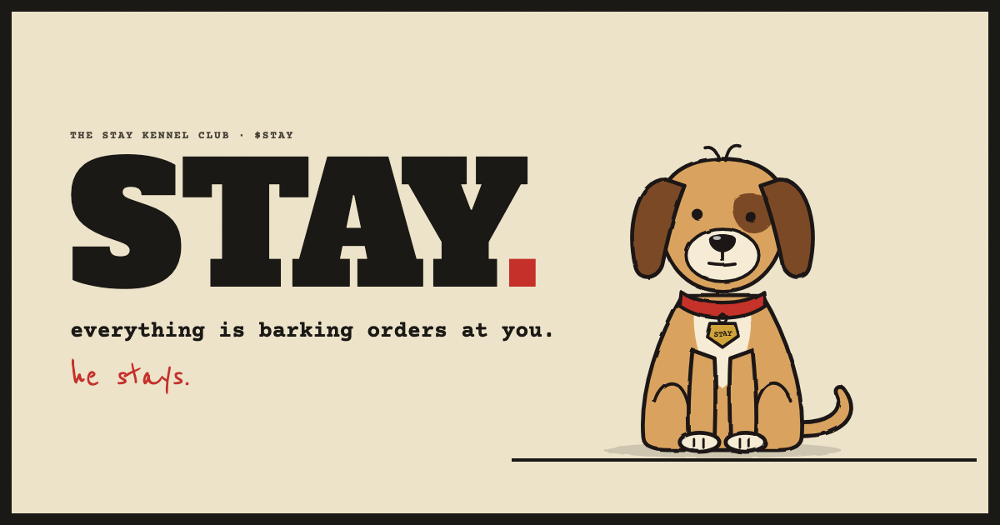

<div align="center">



# stay.

**a dog with one command.**<br>
the market keeps shouting. he keeps sitting.

`$STAY` · solana · pump.fun<br>
**[stay-site-ashen.vercel.app](https://stay-site-ashen.vercel.app)**

</div>

---

> **kennel rules for this repo**
> 1. the site is plain html, css and js. no build step.
> 2. the keeper is a small node script. it never sells $STAY.
> 3. every add it makes is public, with the lp burned in the same transaction.

---

## 01 — what's in the kennel

| room | file | what it does |
|---|---|---|
| home | `index.html` | the dog, the contract address, roll call, the report card |
| the bowl | `bowl.html` | where the creator fees go, with live receipts from the keeper |
| kennel club | `kennel.html` | house rules, the sit, pfps, registration papers, roll call |
| the yard | `yard.html` | meme maker. draws to a canvas, downloads a png |
| manual | `manual.html` | the docs. eight chapters and a faq |
| adopt | `adopt.html` | how to buy, five steps |
| lost | `404.html` | lost-dog poster |
| the keeper | `keeper/` | claims fees → buys a slice → adds liquidity → burns the lp |

## 02 — launch day

Everything that changes at launch is in **one file**, `assets/js/config.js`:

```js
ca: '',            // the mint from pump.fun
x: '',             // your x profile
keeperUrl: '',     // https://<your keeper host>/log.json
keeperWallet: '',  // the keeper's address
```

Leave a field empty and the buttons that need it show *"at launch"* instead of a dead link.

## 03 — run it locally

```bash
python3 -m http.server 3412
```

then open `http://localhost:3412`.

## 04 — the bowl, in plain words

Every batch, the keeper:

1. **claims** the coin's creator fees (bonding curve and pumpswap),
2. **tops up the buried bone** if its reserve is under 4% of supply,
3. **buys a slice** of $STAY with about half the sol,
4. **pours** that $STAY plus the leftover sol into the canonical pumpswap pool,
5. **burns** the exact lp tokens it was minted, in the same transaction as the deposit.

Step 5 is atomic. If the deposit fails, the burn fails with it, so there's never a moment where the keeper holds lp it could pull. Setup is in [`keeper/README.md`](keeper/README.md).

## 05 — house style

| | |
|---|---|
| paper | `#efe5cc` |
| ink | `#1b1915` |
| trainer's red pen | `#c5302a` |
| ribbon blue | `#1d4b8f` |
| brass tag | `#d1a33a` |
| type | Alfa Slab One · Courier Prime · Reenie Beanie |
| buttons | dog tags: clipped corners, punched hole. never pills |

---

<div align="center">

**stay. is a meme about a dog.** it isn't financial advice and it isn't a promise.<br>
you can lose everything you put in. nobody from here will ever ask for your seed phrase.

*no dogs were asked to move in the making of this repo.*

</div>
